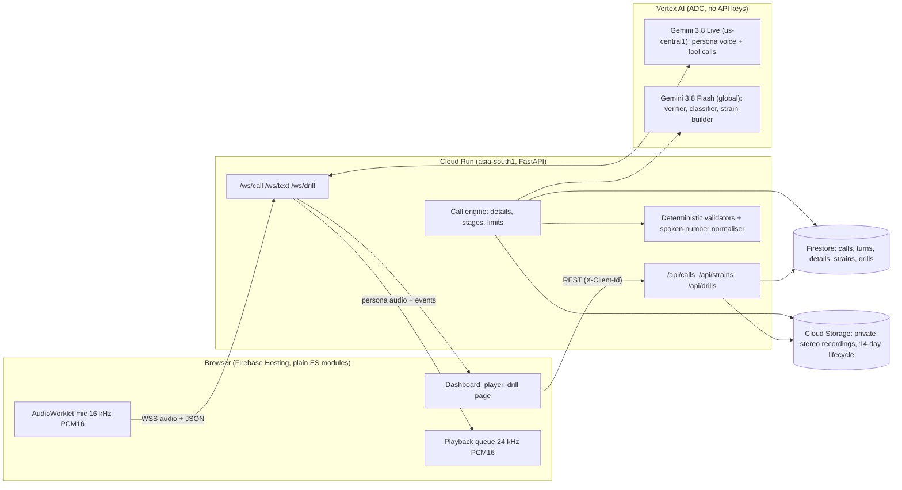

# Honey Trap

**An AI decoy that answers scam calls in English, Hindi and Hinglish, wastes the scammer's time, catches the UPI IDs and bank accounts they ask victims to pay, and turns every captured script into a practice call that protects the next family.**

Built for the Google Cloud AI Builder Cup JAPAC 2026, BFSI theme (Intelligent Risk, Fraud and Financial Experiences).

| | |
|---|---|
| Live app | https://honeytrap-aibc-2026.web.app |
| Watch without a microphone | https://honeytrap-aibc-2026.web.app/#/replay |
| Backend health | https://honeytrap-api-378992821239.asia-south1.run.app/health |

All names, numbers, UPI IDs and accounts in the demo are **fictional**. This is a prototype: a browser stands in for a phone line (see [Limitations](#limitations)).

## The idea: Trap, Strain, Vaccine

1. **Trap.** "Ramesh Sharma", a worried 68-year-old retired schoolteacher from Lucknow, picks up. He speaks the caller's language, stalls, repeats numbers back slowly and asks "sahi hai?" so the caller says the payee details again. Every account number, UPI ID, IFSC, link, name and amount is caught live and checked twice.
2. **Strain.** The finished call becomes a redacted "strain" card: the scammer's script step by step, the three warning signs, how they want the money. No identifiers survive in it.
3. **Vaccine.** A strain becomes a short, consented practice call for a parent or grandparent, built from that day's real script. The actor stops the moment the parent shares a detail or reaches the payment step, and a coach explains the three red flags.

For banks the by-product is an **evidence pack**: confirmed and unconfirmed payee details with quotes, timestamps and confidence, plus the stereo recording. It is a *lead, not a verdict* and says so on every page.

## Try it

| Way | What happens |
|---|---|
| **Live call** (`#/call`) | You play the scammer. Allow the microphone and read a sample line (English, Hinglish or Hindi), or press Send to type it. Ramesh answers in voice; the dashboard fills in as you talk. |
| **Text chat** (`#/chat`) | Same persona and analysis over text. |
| **Replay** (`#/replay`) | A recorded call (synthetic scammer voice vs. the real decoy pipeline). No microphone, no backend, click to seek, jump to key moments. |
| **Review** (`#/history`) | Every call from this browser: recording with click-to-seek transcript, evidence pack (JSON or print to PDF), strain card. |
| **Family drill** (`#/strains`) | Create a consented drill, share the link on WhatsApp. The parent opens a big bilingual "Incoming call" page. |

## Architecture



Key choices:

- **Two independent extraction layers.** The live model calls `record_detail` while it talks; a second, separate Gemini Flash pass with a strict JSON schema re-reads the transcript. A detail is *confirmed* only when both layers saw it (or the caller repeated it) **and** the deterministic validator accepts it (UPI format, 9-18 digit account, IFSC pattern, mobile number, amount).
- **Spoken-form normaliser.** "rahul dot sharma at the rate okaxis", "double nine", Devanagari digits and letter names become `rahul.sharma@okaxis`, `99`, `SBIN0001234`.
- **Voice path stays light.** Verification, classification and strain building run off the audio path; the browser sends its own measured voice-to-voice latency, which the server aggregates (p50 and p90).
- **Barge-in.** When the caller interrupts, the server sends `interrupted` and the browser flushes its playback queue.
- **No client access to data.** Firestore rules deny every browser; everything goes through the backend, which scopes data to a random per-browser id. Recordings are private and fetched with an unguessable per-call token.
- **Cost guards for a public URL.** Per-IP hourly limit, concurrent-session cap, 5-minute call cap, `max-instances 3`, a `KILL_SWITCH` environment flag, budget alerts and a `scripts/stop_billing.ps1` panic button.

### Google Cloud and AI services used

Cloud Run, Firebase Hosting, Firestore (TTL on `expiresAt`), Cloud Storage (lifecycle rule), Vertex AI with Application Default Credentials, Gemini Live API (native audio, function calling, input and output transcription, context-window compression), Gemini Flash (structured JSON output), Cloud Logging (structured JSON logs), Cloud Billing budgets. Gemini TTS is used offline, only to record the demo replay's synthetic scammer.

## Safety, privacy and responsible use

- The persona never gives real personal, bank, Aadhaar, PAN, card, OTP or PIN data, never reveals it is an AI or a trap, never insults or threatens, and ends the call if the caller is clearly not a scammer. See the red-team results below.
- Family drills require explicit consent, only ever ask for made-up details, and stop at the first sign of risk.
- Evidence packs carry the disclaimer: details were stated by an unverified caller and may be mis-heard or belong to an innocent third party. The RBI mule-account SOP is a **draft**; this project does not claim it is in force.
- ICFD-31k is licensed for defensive research. It is used **only** to evaluate the classifier, never for the persona or drill scripts, and it is not stored in this repository.
- Recordings and transcripts are deleted after 14 days (bucket lifecycle and Firestore TTL).

## Run it yourself

```powershell
python -m venv .venv
.\.venv\Scripts\pip install -r backend\requirements-dev.txt
Copy-Item .env.example .env      # fill in project and locations; never commit .env
.\.venv\Scripts\python -m pytest -q
gcloud auth application-default login
.\.venv\Scripts\python -m uvicorn main:app --app-dir backend --port 8080
.\.venv\Scripts\python scripts\serve_frontend.py     # http://localhost:5000/?api=http://localhost:8080
```

Deploy (needs a Google Cloud project with billing; see the scripts for the exact flags):

```powershell
.\scripts\setup_gcp.ps1 -ProjectId <project>
.\scripts\setup_storage.ps1 -ProjectId <project>
.\scripts\deploy_backend.ps1 -ProjectId <project> -AllowedOrigins https://<project>.web.app
firebase deploy --only hosting,firestore --project <project>
```

Useful scripts: `scripts/sim_call.py` (typed or silent-mic simulated caller), `scripts/sim_drill.py` (drill scenarios), `scripts/make_replay.py` (records the replay with a Gemini-TTS scammer), `scripts/stop_billing.ps1`.

Environment variables are documented in [.env.example](.env.example).

## Evaluation

All results are generated by scripts in [eval/](eval/) and committed under `eval/results/`. Read the caveats: the benchmark is synthetic.

<!-- EVAL-RESULTS -->

## Limitations

- **A browser, not a phone line.** There is no telephony or telco diversion in this prototype; that is the roadmap.
- **Two languages of speech, one accent.** English, Hindi and Hinglish work; other Indian languages are not supported.
- **Voice latency is a few seconds**, which suits a hesitant elderly persona but is slower than a natural conversation. Numbers are reported below, not promised.
- **Speech recognition can mis-hear.** That is why details need two checks, and why the evidence pack is a lead, not a verdict.
- **Synthetic benchmark.** ICFD-31k is synthetic; our numbers on it say little about real scams. Real redacted messages are still to be added by the team.
- **In-memory abuse limits** apply per Cloud Run instance only.

## Repository layout

```
backend/            FastAPI app: call engine, Live and text sessions, analysis, validators, recorder, drills
frontend/public/    Static site (plain HTML, CSS, ES modules, no build step) and the recorded replay
scripts/            GCP setup, deploy, simulators, replay recorder, local static server
tests/              pytest unit tests
eval/               Evaluation harness (datasets are git-ignored), committed results
firebase.json       Hosting headers (CSP, caching) and Firestore rules wiring
```

## Data and citations

- ICFD-31k: Ahuja, Prateek and Singh, "ICFD-31k: A Large-Scale Dataset and Benchmark for Real-Time Conversational Fraud Detection", IJCAI-ECAI 2026. Synthetic; evaluation only; not redistributed here.
- National Cybercrime Reporting Portal (NCRP) figure shown on the home page: reported cyber-fraud losses of ₹22,495 crore in 2025.

Code written during the event for the AI Builder Cup 2026. Licence: MIT.
